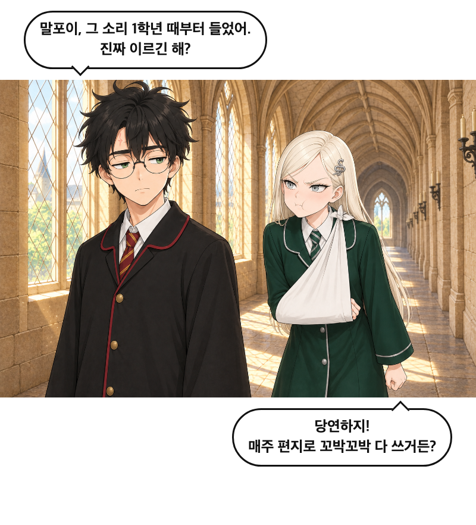
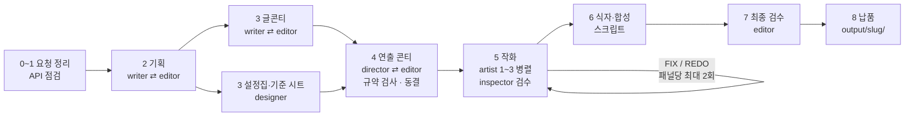

# 단편 웹툰 제작 하네스

아이디어 한 줄을 받아 **기획 → 설정집 → 글콘티 → 연출 콘티 → AI 작화 → 식자·합성**을 거쳐 세로 스크롤 웹툰(HTML 뷰어 + 게시용 PNG 조각)을 만드는 Claude Code 에이전트 팀이다. 작가·편집자·캐릭터 디자이너·연출가·작화가·검수자 역할의 서브에이전트 6종과, 이들을 조율하는 오케스트레이터 스킬로 이루어져 있다.

## 샘플: 「아버지가 아시게 될 거야」

> **입력:** "일단 세컷짜리 어그로용으로 만들어줘. 주제는 요즘 유행하는 ts 말포이인데, 유입이 많이 되도록 확 어그로를 끌만한 주제나, 그림이어야해"
>
> 그림 컷 3개 · 이미지 생성 9장(재생성 포함) · `gpt-image-2.5-flare` / quality `medium`

<p align="center">
  <br>
  <br>
  
</p>

위 이미지는 SNS·커뮤니티 게시용 칸별 조각(`strips_sns/`, 폭 800px)이다. 원작 인물을 패러디한 비상업적 팬 창작 예시이며, 원작의 권리는 원작자에게 있다.

## 동작 방식

메인 에이전트가 `webtoon-orchestrator` 스킬을 따라 팀을 조율한다. 단계마다 편집자 검토와 사용자 확인을 거치고, 비용이 드는 작화 직전에는 콘티와 설정집을 해시로 동결한다.



| 단계 | 하는 일 | 실행 방식 |
|------|---------|-----------|
| 1 요청 정리 | 아이디어·톤·분량·피할 요소를 정리하고 이미지 API를 점검한다. 키가 없으면 자리표시 그림으로 끝까지 가는 dry-run을 제안한다 | 메인 |
| 2 기획 | 로그라인·인물·비트 시트를 쓰고, 편집자 지적을 최대 2회 왕복으로 반영한다 | 지속형 에이전트 |
| 3 설정집 ‖ 글콘티 | 화풍·캐릭터 외형 앵커와 기준 시트 이미지, 컷 단위 각본을 **병렬**로 만든다 | 서브에이전트 + 지속형 |
| 4 연출 콘티 | 컷별 샷·앵글·패널 크기·여백·말풍선 위치와 작화용 영어 프롬프트를 `storyboard.json`으로 정하고 `validate_storyboard.mjs`로 검사한다 | 지속형 에이전트 |
| 5 작화 | 기준 시트를 참조 이미지로 넘겨 패널을 그리고, 검수자가 PASS/FIX/REDO를 판정한다. 절반 이상이 같은 이유로 REDO면 재생성을 멈추고 설정집부터 고친다 | 작화가 병렬 + 단발 검수자 |
| 6 식자·합성 | 말풍선·효과음을 얹어 HTML 뷰어와 게시처별 PNG 조각을 만든다 | 스크립트 |
| 7 최종 검수 | 완성본을 보고 필수 수정을 담당자별로 나눠 1회 반영한다 | 지속형 에이전트 |
| 8 납품 | `output/{slug}/`에 완성본과 기획·콘티·설정집을 모은다 | 메인 |

## 제작 팀

| 에이전트 | 모델 | 역할 |
|----------|------|------|
| `webtoon-writer` | opus | 아이디어를 기획안과 컷 단위 글콘티·대사로 만든다. 피드백을 받으면 지적된 부분만 고친다 |
| `webtoon-editor` | opus | 기획안·글콘티·콘티·완성본을 단계별로 검토해 필수/권장 수정을 담당자별로 정리한다(읽기 전용) |
| `character-designer` | opus | 설정집(`bible.json`)과 캐릭터 기준 시트·화풍 기준 이미지를 만들고 자가 검수한다 |
| `storyboard-director` | opus | 글콘티를 세로 스크롤 연출 콘티로 옮기고 규약 검사를 통과시킨다 |
| `panel-artist` | sonnet | 콘티와 설정집으로 패널 프롬프트를 조립해 그리고, FIX/REDO 판정을 받은 패널만 다시 그린다 |
| `panel-inspector` | sonnet | 패널을 콘티·설정집·기준 시트와 대조해 인물 일치·의상·표정·글자 흔적·화풍을 점검한다(읽기 전용) |

| 스킬 | 담당 |
|------|------|
| `webtoon-orchestrator` | 전체 흐름 조율, 부분 재실행 판단 |
| `webtoon-storytelling` | 기획안·글콘티 작법(AI 작화 제약을 고려한 이야기 설계) |
| `webtoon-review` | 편집자 검토 체크리스트 |
| `webtoon-character-design` | 설정집·기준 시트 |
| `webtoon-storyboard` | 연출 콘티 작성과 검사 스크립트 |
| `webtoon-panel-art` | 이미지 생성 스크립트와 패널 검수 체크리스트 |
| `webtoon-lettering` | 식자·합성 스크립트, 게시처별 출력 |

## 사용법

### 준비

- [Claude Code](https://claude.com/claude-code)
- Node.js(외부 패키지 의존성 없음)
- Google Chrome: 합성 단계에서 HTML을 PNG로 렌더링한다. 기본 위치에 없으면 `.env`의 `CHROME_PATH`로 지정한다
- OpenAI API 키

```bash
cp .env.example .env   # OPENAI_API_KEY 입력
node .claude/skills/webtoon-panel-art/scripts/generate_image.mjs --check
```

### 요청 예

이 폴더에서 Claude Code를 열고 말로 요청한다.

- "새벽 편의점 알바생이랑 매일 오는 고양이 이야기로 10컷 웹툰 만들어줘. 따뜻하고 살짝 웃기게."
- "세 컷짜리 인스타툰으로, 확인 없이 끝까지 만들어줘."

만든 웹툰은 필요한 단계만 다시 실행해 고친다.

| 요청 예 | 다시 하는 단계 | 새로 그리는 이미지 |
|---------|---------------|-------------------|
| "대사 더 짧게", 오타, 말풍선 위치 | 식자·합성 | 없음 |
| "3번 컷 표정만 다시" | 해당 패널 작화 → 합성 | 해당 컷 |
| 구도·컷 순서 변경 | 콘티 → 바뀐 패널 작화 → 합성 → 검수 | 바뀐 컷 |
| "주인공 머리를 단발로" | 설정집 → 그 인물이 나오는 패널 전부 | 해당 컷 전부 |
| "결말 바꿔줘" | 글콘티 → 콘티 → 바뀐 패널 | 바뀐 컷 |
| "같은 캐릭터로 2화" | 이전 설정집을 재사용해 새로 제작 | 새 화 전부 |

## 산출물

```
output/{slug}/
├── episode.html     브라우저용 세로 스크롤 뷰어
├── strips_sns/      커뮤니티·X·인스타용 칸별 조각(첫 조각 = 첫 컷 = 썸네일)
├── strips_full/     한 장짜리 세로 이미지
├── strips/          웹툰 플랫폼용 800×1280 고정 분할(요청 시)
├── panels/          말풍선 없는 원본 패널
├── concept.md       기획안
├── script.md        글콘티
├── storyboard.json  연출 콘티
└── bible/           설정집과 기준 시트
```

작업 중간 산출물은 `_workspace/`에 남고, 저장소에는 올리지 않는다.

## 저장소 구조

```
.claude/
├── agents/          제작 팀 서브에이전트 정의 6종
└── skills/          오케스트레이터와 단계별 스킬 7종(scripts/, references/ 포함)
output/              샘플 웹툰 이미지(strips_sns/)
CLAUDE.md            하네스 호출 조건과 변경 이력
```
